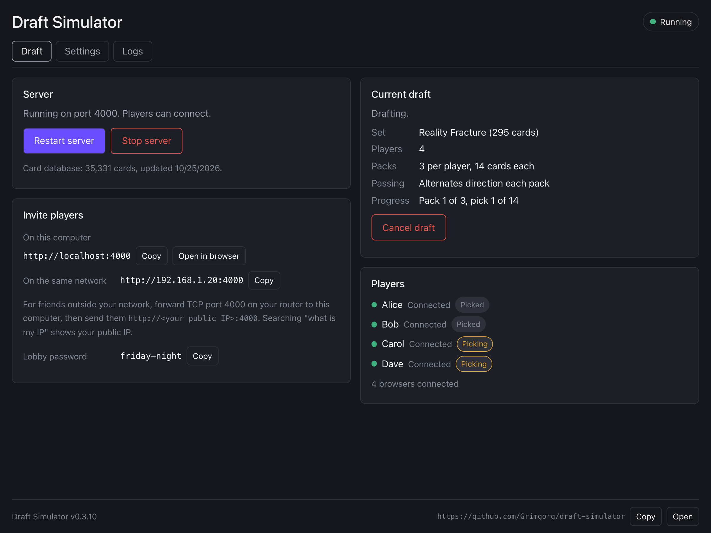

# Draft Simulator

A self-hosted Magic: The Gathering cube draft simulator for a small group of friends. One person runs the server on their PC, imports a cube from [CubeCobra](https://cubecobra.com) or picks a set to draft from its boosters, and everyone else joins over the browser to draft together — packs, pass-direction rotation, live "who's still picking" status, and a decklist export at the end.

Developed with the help of AI coding assistants (Claude Code).

Want to run it from source, work on the code or build a release? See [DEVELOPMENT.md](DEVELOPMENT.md).

## Download and run

Only the host installs Draft Simulator. Everyone else just opens its address in a browser.

### Install

1. Download the installer for your computer from the repository's [Releases](https://github.com/Grimgorg/draft-simulator/releases) page.
   - Windows: `draft-simulator-windows-x64-setup.exe`
   - Mac with Apple Silicon (M1 and newer): `draft-simulator-macos-arm64.dmg`
   - Intel Mac: `draft-simulator-macos-x64.dmg`
   - Linux: `draft-simulator-linux-x64.AppImage` (make it executable, then run it), or `draft-simulator-linux-x64.deb`
2. Install it: run the Windows installer, or drag Draft Simulator from the `.dmg` into Applications.
3. Start Draft Simulator. Its window is the **management UI**, from which you run the server. Click **Start server** when you're ready for players to connect. If a draft was still open or under way when you closed the app, the server starts by itself, so players get back in. The server runs while the window is open; closing it stops the server. The first start downloads the card database, which takes a minute, and the **Logs** tab shows how far along it is.

### Where your data is stored

Everything the server stores goes in your user's app data folder: a `data/` folder with the card database, image cache and running draft, and a `.env` settings file.
- Windows: `%APPDATA%\io.github.grimgorg.draft-simulator`
- macOS: `~/Library/Application Support/io.github.grimgorg.draft-simulator`
- Linux: `~/.local/share/io.github.grimgorg.draft-simulator`

The management UI saves the port and password in `.env`. For the other settings, remove the `#` in front of the line (see [Configuration](#configuration)) and restart.

### Updates

At each start the app checks this repository's latest release. If it's newer, the app asks whether to update. **Update now** downloads it, installs it and restarts the app. Connected players lose their connection until the server is back, then pick up where they left off. **Later** asks again at the next start. This works for the Windows installer, the macOS app and the AppImage. With the `.deb`, or with version 0.3.3 or older, install the new version from the Releases page by hand.

### First-start warnings

The app isn't code-signed, so the system warns you the first time:
- **macOS:** "Draft Simulator can't be opened" or "is damaged". Open **System Settings → Privacy & Security** and click **Open Anyway** next to Draft Simulator. Or run `xattr -cr "/Applications/Draft Simulator.app"` in Terminal once.
- **Windows:** SmartScreen says "Windows protected your PC". Click **More info**, then **Run anyway**. When the firewall asks about `draft-simulator-server`, allow access, otherwise friends can't connect.

### Friends outside your network

They need the port forwarded. In your router's settings, forward the TCP port shown in the management UI (4000 by default) to this computer. Then send them `http://<your public IP>:4000`. Searching "what is my IP" shows your public IP.

## Configuration

Settings are environment variables the server reads at startup, from the `.env` file in the app data folder (see [Where your data is stored](#where-your-data-is-stored)). A real environment variable takes precedence over the same setting in `.env`.

- `PORT` — defaults to `4000`. Also set in the management UI.
- `LOBBY_PASSWORD` — unset by default (no password required). If set, everyone must enter this password before they can connect at all — useful if you're exposing the server beyond your LAN (e.g. port-forwarding it to the internet for a remote draft). It's a single shared password for the whole server, not per-draft. Also set in the management UI.
- `CARD_CACHE_MAX_AGE_DAYS` — defaults to `30`. The server checks the card database at every start and downloads it again in the background once it's older than this many days.

The management UI saves the port and password to the `.env` file. A real environment variable still wins when the app starts, so with `PORT` or `LOBBY_PASSWORD` set in the environment, a saved value only lasts until the next start.

## How a draft works

1. In the management UI, the host clicks **Create draft** and picks the kind of draft:
   - **Cube draft:** paste a CubeCobra cube's URL (or ID) and set the number of packs and cards per pack.
   - **Set draft:** pick the set from the list (so far Reality Fracture) and set the number of packs. Every pack is a freshly opened 14-card Play Booster, with the set's real rarities, its echoed pairs and its alternate-frame versions.

   Then click **Start draft**. Until then, the player page says the host needs to create a draft first. A set draft needs the set in the card database, which Draft Simulator downloads at startup: after updating, the first start downloads it again.
2. Everyone, the host included, opens the player page and joins with their name.
3. Once everyone has joined (at least two players), the host clicks **Start picking** in the management UI. There's no seat limit: the draft is for everyone who joined by then. **Cancel draft** ends it for everyone, before or during the picks.
4. Everyone picks from their own pack each round; packs rotate automatically once everyone's picked. There's no time limit.
5. If someone's browser refreshes or their connection drops, reopening the same URL in the same browser resumes them automatically. If it's a new browser or device (or the old one lost its storage), open the URL and pick your name from the "Rejoin as..." list — this works at any point in the draft, not just the lobby.
6. Once the last pack is empty, everyone gets their own pool and can copy or download their picks as a decklist.

## Known limitations

- One draft at a time per server instance — the host has to finish or cancel it before creating the next one. Creating a new draft after a finished one clears the finished one, so players should copy their decklists first.
- Identity is trust-based, not authenticated: the "Rejoin as..." list shows every player's name and lets anyone pick any seat, since this is meant for a small group of friends who trust each other, not a public server. Picking a name that's still connected elsewhere signs that other session out. If a draft ever gets stuck beyond that, quit Draft Simulator and delete `data/draft-session.json` in its app data folder to reset it. If you're exposing the server beyond your LAN, set `LOBBY_PASSWORD` (see [Configuration](#configuration)) so a stranger who finds the URL can't connect at all.

## License

[MIT](LICENSE). Anyone may use, change and share this code, including commercially, as long as they keep the copyright notice.
